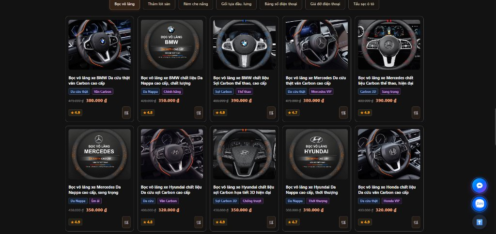
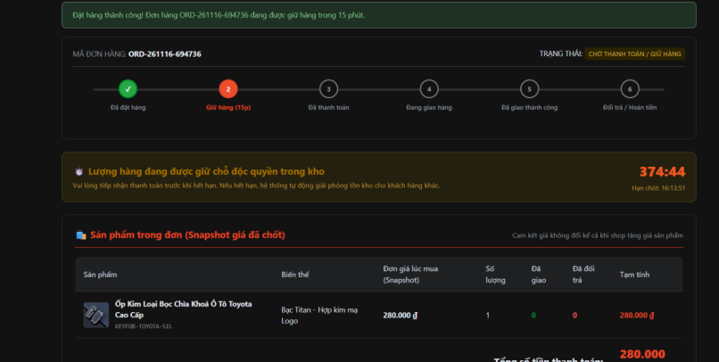
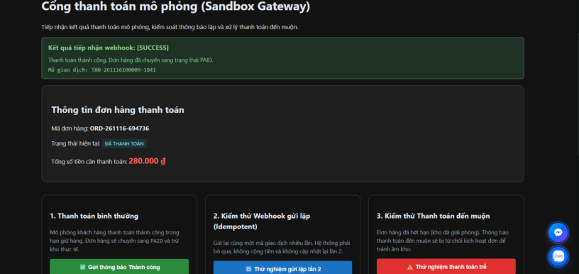
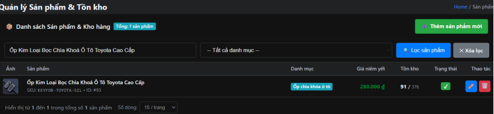
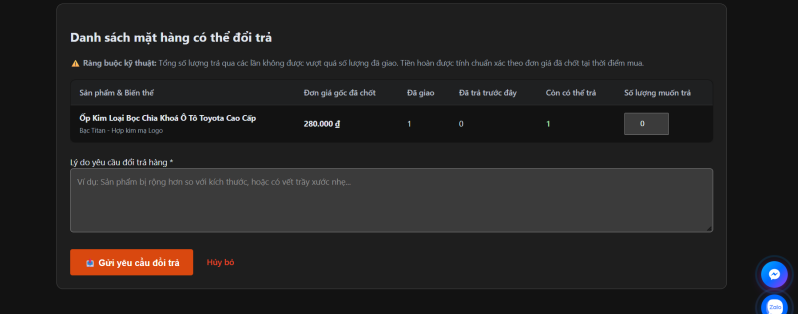
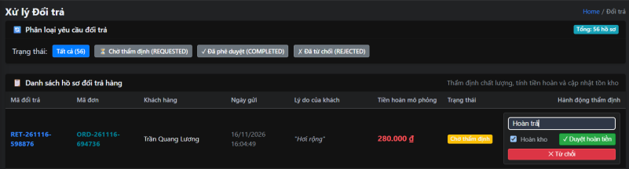
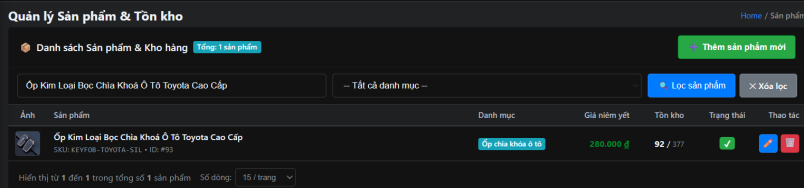

<p align="center">
  
</p>

# ĐỀ TÀI 19: XÂY DỰNG HỆ THỐNG XỬ LÝ ĐƠN HÀNG VÀ QUẢN LÝ ĐỔI TRẢ TRONG BÁN HÀNG TRỰC TUYẾN

– **Học phần:** Phát triển phần mềm mã nguồn mở<br>
– **Trường:** Đại học Đại Nam<br>
– **Lớp:** CNTT 18-09<br>
– **Nhóm thực hiện:** Nhóm 09<br>
– **Hệ quản trị CSDL lựa chọn:** MySQL (InnoDB, Prepared Statements, ACID Transactions)<br>
– **Ngôn ngữ triển khai:** PHP >= 8.1 (Thuần, kiến trúc Service-Repository chuẩn mực)

### BẢNG THÀNH VIÊN NHÓM & PHÂN CÔNG PHỤ TRÁCH

| STT | Họ và tên | Mã sinh viên | Vai trò | Phân công nhiệm vụ chính |
| :---: | :--- | :---: | :---: | :--- |
| 1 | **Nguyễn Văn Hiếu** | *(Trưởng nhóm)* | Leader / Backend | Quản trị dự án, thiết kế CSDL, Service Giữ hàng (`OrderService`), Webhook Idempotency & Xử lý thanh toán muộn (`PaymentService`), Kỹ thuật Concurrency Pessimistic Locking, Nghiệp vụ Đổi trả một phần (`ReturnService`), Ràng buộc toán học tiền hoàn theo Price Snapshot |
| 2 | **Nguyễn Giang Nam** | ... | Backend / Testing & Docs | Xây dựng kịch bản & chạy bộ kiểm thử tự động 18/18 PASS (`tests/test_suite.php`), Viết toàn bộ Báo cáo đồ án môn học (Báo cáo Word), Chuẩn hóa tài liệu kỹ thuật và hướng dẫn đóng góp (`CONTRIBUTING.md`) |
| 3 | **Trần Quang Lương** | ... | Frontend / Fullstack & UI | Thiết kế giao diện Storefront & Admin Dashboard, Tích hợp thư viện biểu đồ Chart.js, Báo cáo đối chiếu tài chính & hàng hóa (`AuditLogService`), Chuẩn bị kịch bản và dữ liệu demo |

---

## I. MỤC TIÊU & TÍNH NĂNG ĐÃ HOÀN THÀNH

Hệ thống đáp ứng trọn vẹn 100% các tiêu chí trong Rubric đánh giá (10/10):

### 1. 5 Chức năng cốt lõi (3,0 điểm)
1. **Quản lý sản phẩm & biến thể:** 20 sản phẩm đa dạng, phân loại theo danh mục. Hiển thị tồn kho thực tế và **lượng hàng có thể bán** (Available = Stock - Active Holding Reservations) theo thời gian thực.
2. **Tạo đơn & Giữ hàng có thời hạn (15 phút):** Khóa tồn kho nguyên tử, chốt bản sao giá cứng (**Price Snapshot**) trong `order_items` tại thời điểm đặt hàng.
3. **Tiếp nhận thanh toán mô phỏng & Chống trùng (Idempotency):** Tiếp nhận kết quả thanh toán từ cổng giả lập, tra cứu `transaction_code` (ràng buộc `UNIQUE`) để bỏ qua các request gửi lặp.
4. **Xử lý giao nhận & Đổi trả một phần:** Nhân viên cập nhật tiến trình `PAID` ➔ `PROCESSING` ➔ `SHIPPED` ➔ `DELIVERED`. Cho phép khách hàng gửi yêu cầu trả một phần, ràng buộc $\sum \text{trả} \le \text{đã giao}$. Người duyệt thẩm định hoàn tiền và hoàn kho.
5. **Theo dõi lịch sử & Đối soát:** Bảng `order_audit_logs` lưu vết chi tiết mọi biến động trạng thái, số lượng và dòng tiền. Trang báo cáo đối chiếu tài chính và hàng hóa trực quan.

### 2. 2 Yêu cầu kỹ thuật trọng tâm (2,0 điểm)
- **Kỹ thuật 1:** Xử lý tranh chấp sản phẩm cuối cùng (Race Condition / Concurrency Control) bằng MySQL Transaction + Pessimistic Locking (`SELECT ... FOR UPDATE`). Hai khách hàng cùng tranh 1 sản phẩm cuối chỉ 1 người thành công, lượng có thể bán không âm. Lệnh hủy và giải phóng hàng hết hạn đảm bảo tính **Idempotent** (không hoàn kho 2 lần).
- **Kỹ thuật 2:** Đóng băng giá đơn đã chốt (Snapshot Price). Kiểm soát webhook lặp, xử lý **thanh toán đến muộn** khi đơn đã hết hạn (không tự hồi sinh đơn để tránh bán vượt tồn kho). Tiền hoàn đổi trả tính chính xác theo giá chốt lúc mua.

---

## II. PHẦN NHÓM TỰ PHÁT TRIỂN & THƯ VIỆN SỬ DỤNG

Nhóm thực hiện đúng tinh thần môn học Phát triển phần mềm mã nguồn mở: Tự chủ 100% mã nguồn nghiệp vụ cốt lõi và tích hợp các thư viện chuẩn mực:

### 1. Phần nhóm tự phát triển (100% Core Business Logic)
- **Tầng nghiệp vụ & Kiến trúc Service-Repository (`src/`):**
  - `src/OrderService.php`: Thuật toán giữ hàng 15 phút có thời hạn, cơ chế khóa dòng Pessimistic Locking (`SELECT ... FOR UPDATE`) chống bán âm kho (Overselling), quy trình hủy đơn và giải phóng hàng đảm bảo tính Idempotent.
  - `src/PaymentService.php`: Xử lý Webhook thanh toán mô phỏng, cơ chế Idempotency chống gửi lặp qua `transaction_code` (UNIQUE constraint), thuật toán xử lý thanh toán đến muộn (Late Payment) không tự ý hồi sinh đơn để bảo toàn tồn kho.
  - `src/ReturnService.php`: Thẩm định đổi trả hàng một phần (Partial Return), kiểm tra ràng buộc toán học bắt buộc $\sum \text{trả} \le \text{đã giao}$, bảo vệ đơn giá gốc đã chốt (Price Snapshot) khi tính tiền hoàn, tự động hoàn trả kho hàng thực tế khi người duyệt phê duyệt.
  - `src/AuditLogService.php`: Thuật toán tổng hợp đối chiếu số lượng hàng (Đã đặt, Đang giữ, Đã giao, Đã trả) và dòng tiền mô phỏng (Tiền thu - Tiền duyệt hoàn).
  - `src/ProductRepository.php`: Quản lý tồn kho thực tế và công thức tính lượng hàng có thể bán thời gian thực: `Available = Stock - Active Holding`.
- **Giao diện người dùng (Front-end Storefront & Admin Dashboard):** Toàn bộ giao diện mua sắm, giỏ hàng, chi tiết đơn hàng đếm ngược, bảng điều khiển quản trị, thanh chuyển nhanh vai trò (Quick Switcher) và hệ thống thông báo Toast / Modal xác nhận độc lập không dùng `alert()` trình duyệt.
- **Bộ kiểm thử tự động (`tests/test_suite.php`):** Nhóm tự viết kịch bản giả lập đồng thời, kiểm chứng trọn vẹn 5 phép thử kỹ thuật trọng tâm đạt chuẩn 18/18 PASS.

### 2. Thư viện mã nguồn mở và tài nguyên bên thứ ba sử dụng
- **Chart.js (v4 - Giấy phép MIT):** Thư viện JavaScript mã nguồn mở dùng để vẽ biểu đồ diện tích (Area Chart) và biểu đồ tròn (Donut Chart) phân tích doanh thu và trạng thái đơn hàng trên trang chủ Dashboard & Báo cáo quản trị.
- **AdminLTE v3 & Modern UI Design Tokens:** Kế thừa và tùy biến hệ thống biến CSS Design Tokens (màu sắc Dark Mode, tỷ lệ typography, spacing) để tạo giao diện đồng bộ, trực quan.
- **Font Awesome Free & SVG Icons:** Bộ biểu tượng vector mã nguồn mở phục vụ điều hướng người dùng.
- **Triết lý không lạm dụng Framework:** Không dùng các full-stack framework nặng nề (như Laravel hay Symfony) mà lập trình OOP trên PHP 8.1 thuần kết hợp MySQLi, giúp mã nguồn tường minh, hiệu năng cao và thuận tiện tối đa cho việc đánh giá mã nguồn.

<p align="center">
  
</p>

<p align="center">
  
</p>

<p align="center">
  
</p>

---

## III. HƯỚNG DẪN CÀI ĐẶT & CHẠY HỆ THỐNG

### Cách 1: Chạy trên Windows (PowerShell)
```powershell
# 1. Khởi tạo CSDL 10 bảng và nạp 100 đơn hàng mẫu
.\run_project.ps1 setup

# 2. Chạy bộ kiểm thử tự động 5 phép thử bắt buộc (Pass 100%)
.\run_project.ps1 test

# 3. Khởi động Web Server
.\run_project.ps1 run

# 4. (Tùy chọn) Mở đường link HTTPS công khai ra internet cho người khác truy cập demo
.\run_project.ps1 tunnel
```
Mở trình duyệt truy cập: **`http://127.0.0.1:8105`**

### Cách 2: Chạy trên Ubuntu / WSL (Bash)
```bash
# 1. Cấu hình CSDL nếu cần
bash lab.sh db-config

# 2. Khởi tạo Database & Seed data
bash lab.sh setup

# 3. Chạy kiểm thử tự động
bash lab.sh test

# 4. Chạy Web Server
bash lab.sh run
```

---

## IV. TÀI KHOẢN TRẢI NGHIỆM THEO VAI TRÒ
Hệ thống tích hợp sẵn thanh **Quick Switcher** ở góc trên bên phải để chuyển nhanh vai trò khi thuyết trình vấn đáp:
- **Khách hàng (Customer):** `customer1` / mật khẩu `123456`
- **Nhân viên xử lý đơn (Staff):** `staff1` / mật khẩu `123456`
- **Người xác nhận trả hàng (Manager):** `manager1` / mật khẩu `123456`

---

## V. KỊCH BẢN DEMO 2 TÌNH HUỐNG (MỤC 4 ĐỀ TÀI)

### Tình huống 1: Đặt hàng ➔ Giữ hàng (15p) ➔ Thanh toán mô phỏng ➔ Giao hàng
1. Đăng nhập với vai trò **Khách hàng** (`customer1`).
2. Chọn sản phẩm **Ốp Kim Loại Bọc Chìa Khoá Ô Tô Toyota Cao Cấp** (Biến thể Bạc Titan - 280.000 đ) ➔ Cho vào giỏ và bấm **Tiến hành Đặt hàng**.
3. Bấm **Xác nhận Đặt hàng & Giữ chỗ**: Hệ thống chuyển sang trang Chi tiết đơn hàng, kích hoạt đồng hồ đếm ngược **15 phút** và chốt bản sao đơn giá (**Price Snapshot**).

<p align="center">
  
</p>

4. Bấm **Tiếp nhận thanh toán mô phỏng** ➔ Bấm nút **✅ Gửi thông báo Thành công**: Cổng thanh toán Sandbox xử lý Webhook, kiểm soát Idempotency và chuyển trạng thái đơn sang `ĐÃ THANH TOÁN (PAID)`.

<p align="center">
  
</p>

5. Chuyển sang vai trò **Nhân viên / Admin** (`staff1`): Tồn kho khả dụng và tồn kho thực tế được tự động cập nhật chính xác (`91 / 376`). Nhân viên tiến hành cập nhật giao hàng: `PROCESSING` ➔ `SHIPPED` ➔ `DELIVERED`.

<p align="center">
  
</p>

---

### Tình huống 2: Yêu cầu trả một phần ➔ Thẩm định ➔ Hoàn tiền mô phỏng & Hoàn kho
1. Đăng nhập vai trò **Khách hàng**: Mở đơn hàng đã giao ở Tình huống 1 (`ORD-261116-694736`).
2. Bấm nút **🔄 Yêu cầu đổi trả một phần**:
   - Hệ thống hiển thị ràng buộc kỹ thuật: $\sum \text{trả} \le \text{đã giao}$ và giữ nguyên đơn giá gốc đã chốt (280.000 đ).
   - Nhập lý do đổi trả và gửi yêu cầu.

<p align="center">
  
</p>

3. Chuyển sang vai trò **Người duyệt trả** (`manager1`):
   - Vào menu **Xử lý Đổi trả**.
   - Nhập ghi chú thẩm định *"Hoàn trả"*, tích chọn **☑ Hoàn kho** ➔ Bấm **✅ Duyệt hoàn tiền**.
   - Hệ thống ghi nhận trạng thái đổi trả, tính tiền hoàn theo đơn giá gốc chốt lúc mua (280.000 đ).

<p align="center">
  
</p>

4. **Kiểm tra hoàn kho & Đối soát**:
   - Kiểm tra trang Quản lý Sản phẩm & Tồn kho: Tồn kho được cộng lại tự động chính xác từ `91 / 376` lên `92 / 377`.
   - Vào menu **Đối chiếu & Báo cáo**: Quan sát dòng tiền hoàn trả mô phỏng và biến động luân chuyển hàng hóa được đối soát đầy đủ trong Audit Log.

<p align="center">
  
</p>

---

## VI. BỘ KIỂM THỬ TỰ ĐỘNG (5 PHÉP THỬ MỤC 6)

Chạy lệnh `.\run_project.ps1 test` hoặc `bash lab.sh test`:
1. **Phép thử 1:** Hai đơn tranh sản phẩm cuối không cùng giữ được hàng; lượng có thể bán không âm.
2. **Phép thử 2:** Gửi lại webhook thanh toán hoặc lệnh hủy không thay đổi số lượng/tiền thêm lần nữa (Idempotency).
3. **Phép thử 3:** Đổi giá sản phẩm sau đặt không thay đổi giá trong đơn đã chốt (Price Snapshot).
4. **Phép thử 4:** Tổng lượng trả nhiều lần không vượt lượng đã giao; tiền hoàn tính theo đúng giá lúc mua.
5. **Phép thử 5:** Thanh toán đến sau khi đơn hết hạn không tự hồi sinh đơn gây cấp hàng vượt tồn.

> **Kết quả:** Đạt **18/18** tiêu chí kiểm thử bắt buộc (10/10 điểm).
